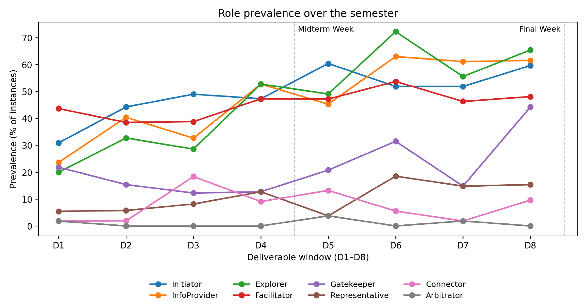

The person who proposes an idea today may be the one questioning others’ ideas tomorrow or the one inviting a quiet teammate into the discussion next week. The shift of these team roles is easy to miss if we describe a team only by who talks the most.

In our [ACL 2026 paper](https://aclanthology.org/2026.acl-long.1930/), we study communication roles across semester-long team projects. We find that students take on multiple roles and that role patterns change with project phases. These patterns then provide predictive signals for peer recognition and team performance.

## Looking at what people do in conversation

We analyzed 6,307 Slack messages from 55 students across 18 teams in a university user interface design course. Drawing on a team role taxonomy from behavioral science research [[1]](#reference-1), we labeled eight communication roles for each student's chat history within each of the project stages (separated by deliverables).

| Role | Shorthand description |
|------|-----------------------|
| Initiator | Initiate process |
| Explorer | Ask questions |
| Information Provider | Provide detailed information |
| Facilitator | Summarize / control discussion |
| Arbitrator | Solve disagreement |
| Representative | Express / answer for team |
| Gatekeeper | Fill gaps / invite others |
| Connector | Connect people/resources |

We found out that roles shifted as the work changed (Figure 1). As a multi-hot labeling process, we also found that students enacted a diverse range of roles as the semester progressed, averaging 2.3 roles per person per stage.

*Figure 1 in the paper: Role prevalence across deliverable windows. Vertical dashed lines mark midterm week (between D4 and D5) and final week (after D8). Peaks align with phase-specific demands: connector rises during user research (D3), work/coordination roles (explorer, information provider, facilitator) increase when starting to implement the prototype (D6), and gatekeeper peaks near the final deadline when everyone is busy and pressured (D8).*

## Roles add useful signals for prediction

We also tested whether a large language model (LLM) could reproduce expert role labels. The best model performed well overall, especially on common roles, but struggled more with context-dependent behaviors such as representative, who needs to speak for the team.

To test the labels' usefulness, we predicted peer recognition: how teammates rated a student's contribution relative to their team's average. Models using role labels outperformed models based on common conversation statistics (e.g., message length, sentiment, readability), as well as direct prompting using the same LLM.

We then applied the same role labeling process to DeliData [[2]](#reference-2), a public dataset of 500 group discussions on a reasoning task. Combining roles with conversation statistics improved prediction of whether a group's answer would improve after discussion.

| | Peer recognition | Team Performance |
|---|------------------|------------------|
| Conversation features | 0.65 | 0.70 |
| Zero-shot prompting | 0.70 | 0.68 |
| **Our role-based approach** | 0.73 | 0.74 |

*Selected results from Tables 6 and 7 of the paper. Scores are ROC-AUC on binary prediction tasks: higher is better.*

## Final Thoughts

Our findings highlight the value of tracking communication roles to better understand, evaluate, and support effective collaboration—pointing toward designing tools that help teams reflect on how they work together or building agents to join a team’s conversation. For example, if a discussion produces questions but little synthesis, the agent could suggest summarizing decisions or agreeing on next steps.

**Read our [paper here](https://aclanthology.org/2026.acl-long.1930/) and cite us if it’s relevant to your research!**

Yifan Song, Wenxuan Wendy Shi, Brian Bailey, and Tal August. 2026. [Who Plays Which Role When? Communication Role Dynamics for Peer Recognition and Team Performance Prediction.](https://aclanthology.org/2026.acl-long.1930/) ACL 2026.

